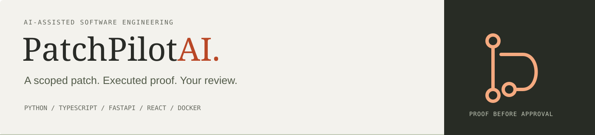
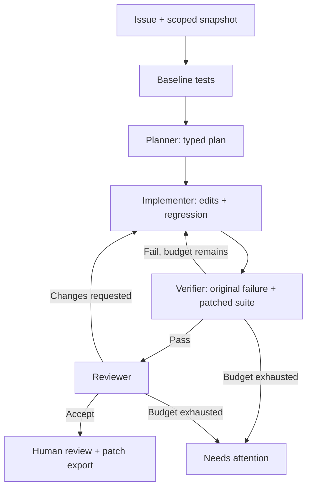

# PatchPilot AI

**Supervised software repair agents with executable evidence.**

PatchPilot turns a reported bug in a small Python repository into a scoped source patch, a regression test, an execution trace, and a human review checkpoint. Model roles propose changes; deterministic tools control edits and verification. Every run keeps its evidence, usage, and review decision together.

Built by [Harikrishna Trivedi](https://github.com/HK0922) with AI-assisted implementation and human supervision. Current version: **0.2.0**, a working local engineering prototype.

[Quick start](#quick-start) · [Your repository](#repair-your-own-module) · [Architecture](docs/ARCHITECTURE.md) · [Evaluation](docs/EVALUATION.md) · [Contributing](CONTRIBUTING.md)

## Why this project

A plausible patch is only the start of a repair. A useful agent also needs a clear scope, reproducible failure evidence, preserved existing tests, bounded retries, and an understandable handoff. PatchPilot makes those steps inspectable so a developer can supervise the outcome.

The project demonstrates AI-assisted engineering through typed contracts, tool verification, explicit boundaries, and reproducible artifacts. It makes no unmeasured claims about productivity gains or general model repair accuracy.

## What you can do

| Capability | What happens |
| --- | --- |
| Prepare a repair | Import Python source and unittest files, describe the bug, and set acceptance criteria. |
| Control scope | Choose the existing source files the agent may edit and set attempt/token budgets. |
| Save work | Keep up to eight draft requests in a browser-local queue with priority, reopen, delete, and undo. |
| Move a request | Export a portable `.patchpilot.json` and import it through the local API or CLI. |
| Execute a repair | Run planner, implementer, verifier, and reviewer roles; retry using failure evidence. |
| Inspect the proof | Read a unified diff, original regression failure, patched suite, activity, and reviewer concerns. |
| Make the decision | Approve or reject a verified handoff locally, then download its patch and PR description. |
| Review exported runs | Import `run.json` into the hosted workspace; supplied results stay visibly labeled. |

**Version 2** adds repository intake, editable issue criteria, a saved issue queue, portable request import, and evidence import. [Version 2 guide](docs/VERSION_2.md)

## Execution modes

| Mode | Needs | Executes code? | Calls a model? |
| --- | --- | --- | --- |
| Browser workspace | A browser | No | No |
| Local scripted demo | Python and the built dashboard | Trusted bundled fixture tests | No; uses known repair recipes |
| Local live repair | Server-side API key, supported model, Docker image | Candidate tests inside Docker | Yes; structured OpenAI Responses |

The [hosted workspace](https://patchpilot-ai.arun-patel-1827.chatgpt.site) and [earlier interface](https://patchpilot-ai.arun-patel-1827.chatgpt.site/v1/) currently have restricted access. Run locally to explore the complete application. The hosted page supports intake and evidence review; it does not run live repairs.

## Quick start

Requirements: **Python 3.11+**, **Node.js 20.19+ or 22.12+**, and npm. Docker is required for live repairs; scripted demos need no model credentials.

```bash
git clone https://github.com/HK0922/patchpilot-ai.git
cd patchpilot-ai
python3 -m venv .venv
source .venv/bin/activate
python -m pip install -r requirements.lock
python -m pip install -e . --no-deps
cd web
npm ci
npm run build
cd ..
patchpilot serve
```

Open **http://127.0.0.1:8000**. Choose **Explore an executed workflow** to replay an existing trace, or open **Repair runs** and execute a scripted fixture locally.

Windows commands and troubleshooting: [SETUP.md](docs/SETUP.md). `.env.example` documents environment variables; the service does not automatically load `.env` files.

### Run a reproducible demo

```bash
patchpilot run pagination
patchpilot run invoice --attempts 3
patchpilot inspect YOUR_RUN_ID
```

Try `patchpilot run invoice --attempts 1` to inspect an intentional failed candidate. It exits with status 1 because verification stops the handoff.

## Repair your own module

1. Open **Your repository** in the local app. Import a small module under `src/` and unittest files under `tests/`.
2. State the failing behavior and acceptance criteria. Select the allowed source edits and budgets.
3. Click **Register with local service**. Registration copies the snapshot without executing it or restarting the service.
4. Configure the model and Docker, inspect the request, and start the live repair.
5. Review the diff and before/after test evidence. Approve/reject locally and apply a reviewed patch manually.

For a request exported from another browser:

```bash
patchpilot import shop-discount-rounding.patchpilot.json
patchpilot run shop-discount-rounding --mode openai
patchpilot inspect YOUR_RUN_ID > run.json
```

The exported request supplies the project ID and default attempt/token budgets. Use **Repair runs → Import evidence** on the hosted page to review `run.json`. Those results are supplied by the file and are not re-executed there.

### Enable live execution

```bash
docker build -f Dockerfile.sandbox -t patchpilot-sandbox:0.1 .
export OPENAI_API_KEY="your-key"
export PATCHPILOT_MODEL="your-supported-structured-output-model"
export PATCHPILOT_API_TOKEN="your-random-local-access-token"
patchpilot serve
```

Keep the model key in the server environment. The browser receives neither that key nor shell access. Live mode fails closed when its prerequisites are missing. [Configuration and OS-specific setup](docs/SETUP.md#3-enable-live-model-calls)

## How the repair loop works



A verified handoff requires the new regression to fail with an assertion on the **original** source, the **patched** suite to pass, existing tests to remain unchanged, and the reviewer to recommend approval. Human approval is recorded separately. It never applies, pushes, or merges code.

Three model roles use distinct instructions and calls with one configurable model. The verifier is deterministic code. An explicit state machine coordinates the workflow; no agent receives an arbitrary shell tool.

## Technology

| Layer | Implementation | Purpose |
| --- | --- | --- |
| Interface | React, TypeScript, Vite, Lucide | Repository intake, scope, evidence, and review |
| API and schemas | FastAPI, Pydantic | Validate requests and structured role output |
| Orchestration | Python state machine | Enforce stages, budgets, cancellation, and retries |
| Model provider | OpenAI Responses API via HTTPX | Typed plans, exact edits, and independent review |
| Verification | unittest, Docker, trusted fixture subprocess | Execute regression and complete-suite checks |
| Persistence | SQLite WAL and ordered events | Keep run state, evidence, and human decisions |
| Tests | pytest, Vitest, Testing Library | Exercise policy, API, providers, lifecycle, and UI |
| Delivery | CLI and GitHub Actions | Reproduce runs and validate source changes |

## Validation and results

The latest local validation completed **79 backend tests** and **23 frontend tests** successfully, plus TypeScript checks and the production build. One real-Docker integration test was skipped because Docker was unavailable. The build record describes the test-runner adapter needed in the restricted authoring environment. CI is configured but has not yet been verified on this GitHub repository.

The historical fixture evaluation ran known scripted solutions once per variant:

| Case | One attempt | Up to three attempts | Final passing tests |
| --- | --- | --- | --- |
| Pagination boundary | Handoff | Handoff, 1 attempt | 7 |
| Invoice rounding | Verification stopped | Handoff, 2 attempts | 7 |
| Appointment timezone | Handoff | Handoff, 1 attempt | 7 |
| Slug normalization | Handoff | Handoff, 1 attempt | 7 |
| Prohibited-edit probe | Blocked before applying | — | — |

These results exercise orchestration and retry recovery using known recipes. **They are not an LLM accuracy benchmark or a SWE-bench score.** Real model calls, actual Docker execution, and rendered browser layout/keyboard QA remain unverified in the authoring environment. [Raw results](benchmarks/results.json) · [Evaluation protocol](docs/EVALUATION.md) · [Build record](docs/BUILD_RECORD.md)

### Run the checks

```bash
python -m pytest
python scripts/benchmark.py
cd web
npm test
npm run build
```

On a Docker-capable machine, build the image and set `PATCHPILOT_DOCKER_INTEGRATION=1` when running pytest to include the real-container test.

## Repository map

| Path | Contents |
| --- | --- |
| `patchpilot/` | API, CLI, intake, role providers, engine, workspace policy, sandbox, and storage |
| `web/src/` | React interface, request/evidence utilities, styles, and UI tests |
| `web/public/` | Public frontend assets and historical fixture evidence |
| `examples/` | Four deliberately small repair fixtures and their scripted catalog |
| `tests/` | Backend workflow, policy, provider, API, intake, and sandbox tests |
| `benchmarks/` | Raw scripted evaluation and comparisons |
| `scripts/` | Fixture maintenance, benchmarking, and source packaging |
| `docs/` | Setup, architecture, API, evaluation, demo, and design records |
| `.github/` | CI, issue forms, and pull-request checklist |
| `.agents/` | Project-local UX/UI skills with their upstream licenses and pinned source |

The current `dist/` build, dependency folders, runtime databases, credentials, and downloadable source archives are excluded from the GitHub source repository. `web/public/v1/` deliberately preserves the earlier interface as a historical preview.

## Documentation

| Guide | Use it for |
| --- | --- |
| [Setup](docs/SETUP.md) | Installation, configuration, CLI commands, and troubleshooting |
| [Architecture](docs/ARCHITECTURE.md) | Role contracts, state transitions, evidence gates, and isolation |
| [Version 2](docs/VERSION_2.md) | Repository intake, portability, saved drafts, and imported evidence |
| [API](docs/API.md) | Local endpoints, request formats, and error behavior |
| [Evaluation](docs/EVALUATION.md) | Reproducible scripted results and a proposed live protocol |
| [Demo](docs/DEMO.md) | A concise walkthrough of success, retry, and refusal |
| [AI workflow](docs/AI_WORKFLOW.md) | How human supervision and AI-assisted implementation work together |
| [Roadmap](docs/ROADMAP.md) | Planned extensions and observable completion criteria |

## Scope and next steps

The supported unit is a dependency-free Python module with unittest tests: up to 60 Python files, 64 KiB per file, a 500 KiB snapshot, and a 50 KiB selected source/test context. Only existing allowed source files and one new regression file may change.

This is a loopback-bound local prototype. AST checks are a conservative policy layer, and the configured Docker runner adds isolation; public execution of arbitrary hostile repositories is outside the supported boundary.

Next: validate real model and Docker runs, evaluate held-out issues, then add authenticated GitHub issue intake and review-driven draft PR creation. Dependency-heavy repositories, additional languages, distributed workers, and production multi-user hosting remain planned.

## Contributing and license

Read [CONTRIBUTING.md](CONTRIBUTING.md) before making a change. Use the issue forms for reproducible bugs and scoped feature requests. Security reporting guidance is in [SECURITY.md](SECURITY.md).

PatchPilot is available under the [MIT License](LICENSE). Imported design skills retain the upstream MIT notices recorded in [THIRD_PARTY_NOTICES.md](THIRD_PARTY_NOTICES.md).
