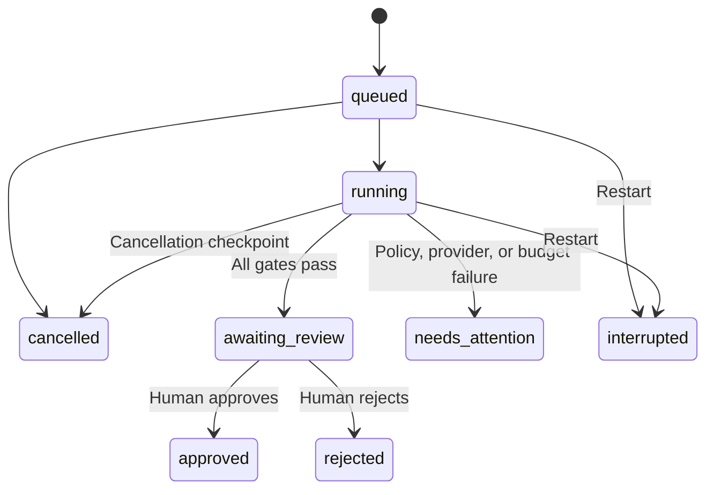

# Architecture

## Responsibility split

The browser supervises runs. FastAPI validates requests and puts jobs onto one local worker. The engine owns the state transitions and tools. Models propose typed objects; they never choose shell commands or mutate the filesystem directly.

| Component | Input | Output / authority |
| --- | --- | --- |
| Planner | Issue, allowed source, baseline evidence | A typed plan; no side effects |
| Implementer | Current source, plan, previous test or review feedback | Exact edits and a new regression test |
| Workspace tool | Proposed edits | Validated changes inside a copied snapshot |
| Verifier | Original snapshot, candidate, new regression | Actual test counts, exit status, timing, and output |
| Reviewer | Issue, plan, original-to-current diff, executed tests | Approve recommendation or request changes |
| Human | Complete evidence and prepared handoff | Saved approve/reject decision |

The three model roles use separate system instructions and calls. A single configurable model serves all three; separate roles do not imply three distinct trained models. The verifier is deterministic code. Demo mode substitutes known typed responses for model calls.

## State and stage

Run status and workflow stage are distinct. Status describes the job lifecycle; stage describes the current tool or role.

Stages: intake, baseline, plan, patch, test, review, complete. Every role and tool transition produces an event. Events are ordinary engineering summaries and evidence, not hidden model reasoning.

## The evidence gate

1. Existing baseline tests must be discoverable and finish without import errors or timeout. They may pass or fail; when they pass, the newly generated regression must still prove the issue.
2. Every edit must reference an existing allowed source file and match exactly one nonempty current-source span.
3. The entire proposal is validated before writing. Each file write uses an atomic replacement inside the disposable snapshot.
4. Existing tests are hashed and cannot be edited. A new test is allowed only at `tests/test_patchpilot_regression.py`.
5. The new regression runs by itself against the original source. It must have a real assertion failure, not an import error or timeout.
6. The full patched suite must pass and contain at least the baseline test count plus the generated regression count.
7. The reviewer must recommend approval.
8. The engine stops at `awaiting_review`. The human's decision is a separate saved action.

Test coverage remains finite. Passing checks are evidence for the specified behavior, not proof of correctness for all inputs.

## Workspace boundary

Snapshots include at most 60 Python files, at most 64 KiB per file, and at most 500 KiB in total. Only relevant source and tests enter the model context, capped at 50 KiB. Python symlinks and unsafe relative edit paths are rejected. Hidden folders and non-Python files are not copied.

Generated files are parsed as Python. A policy filter rejects common system, network, dynamic-loading, file-operation, and reflective constructs. This AST filter is intentionally conservative and can reject otherwise legitimate projects. It is not a complete security boundary for Python.

Live tests run in a prebuilt Docker image with a read-only repository mount, no networking, a non-root user, no additional capabilities, no new privileges, 256 MiB memory, one CPU, and 64 processes. The runner has a wall-clock deadline and 64 KiB output cap. Candidate code is never given model credentials. The Docker CLI runs on the host; the container does not receive host environment variables or the Docker socket.

This configuration was implemented and its invocation checked by automated tests; actual Docker execution was unavailable during the initial build. A personal local service is the intended boundary. Public hostile-code execution would need substantially more isolation and operational controls.

## Budgets and efficiency

- Max implementation attempts: 1-4; default 3.
- Default run deadline: 240 seconds.
- Default per-test deadline: 20 seconds.
- Default total model token budget: 30,000.
- Per-call maximum output: 2,048 tokens for plan/review, 4,096 for a patch.
- A conservative reservation prevents a new call when estimated input plus maximum output would exceed the remaining ceiling.
- Provider usage tracks input, output, total, and cached input tokens. Optional prices produce an explicitly estimated cost.
- No automatic network retry hides extra billed calls. Model failures stop and preserve evidence.

Small source contexts, one scoped patch, bounded feedback loops, and an explicit stop condition are the efficiency mechanisms. Their effect on real model performance must be measured; demo latencies cannot establish inference-time savings.

## Persistence and concurrency

SQLite WAL stores runs and ordered events. Writes use a local lock and transactions. Events have monotonic IDs, allowing an SSE client to resume from a cursor. The React app polls active runs; the SSE endpoint is also available.

One worker executes jobs and accepts a maximum of six queued/running jobs. This keeps resource usage predictable for the local prototype. On service restart, queued or running jobs are marked interrupted. Completed artifacts and decisions remain intact.

Cancellation is cooperative between role calls and tools, and also checked while tests run. An in-flight model HTTP request may wait until its response or timeout before the next cancellation checkpoint.

## Access and exports

The server binds to `127.0.0.1`. Trusted host validation and cross-origin mutation checks limit accidental browser access. A configured bearer token protects API endpoints other than health/config. Keys remain in the server process and are not returned to the browser or exported.

Verified patch downloads are restricted to reviewable, approved, or rejected verified runs. Failed-run evidence can include an explicitly named `unverified-candidate.patch`. Exported evidence is a ZIP containing the run JSON, candidate/verified patch, and prepared PR description when available.

## Primary references checked during implementation

- [OpenAI structured outputs](https://developers.openai.com/api/docs/guides/structured-outputs?api-mode=responses)
- [OpenAI Responses API reference](https://developers.openai.com/api/reference/resources/responses/methods/create)
- [FastAPI lifespan events](https://fastapi.tiangolo.com/advanced/events/)
- [Docker container run reference](https://docs.docker.com/reference/cli/docker/container/run/)
